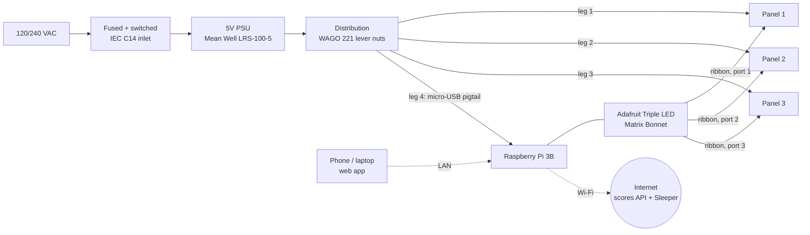
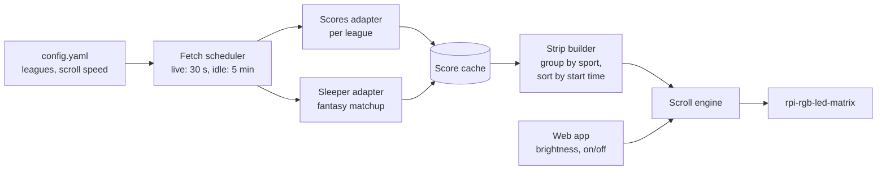

# Rotating LED Scoreboard — Design Document

| | |
|---|---|
| **Status** | Draft — hardware planning |
| **Owner** | Adam |
| **Last updated** | 2026-10-23 |

---

## 1. Overview

A wall-mounted RGB LED matrix display (~2.5 ft / 0.77 m wide) that connects to the internet over Wi-Fi, fetches the day's scores for selected sports leagues, and continuously scrolls through each game on the display. Live games show up-to-date scores; finished games show final scores; upcoming games show start times.

### 1.1 Goals

- Show scores for today's games across several leagues (e.g. NFL, NBA, MLB, NHL, NCAA).
- Rotate automatically and continuously across the panels with scores for each game that day.
- Games are formatted to show team logos with the score and time in between.
- The games should be in order by start time and grouped by sport.
- Show my Sleeper fantasy football team's stats alongside the real scores.
- Run unattended: boots straight into the scoreboard and recovers on its own from network or API outages.
- Be safe and tidy enough to leave running in a home, with mains wiring fully enclosed.
- Controllable with a web app for operations like brightness and display on/off.

---

## 2. Requirements

### 2.1 Functional

| ID | Requirement |
|---|---|
| F1 | Fetch today's schedule and scores for the configured leagues. |
| F2 | Refresh live games every ≤ 30 s; refresh non-live data every ≤ 5 min. |
| F3 | Scroll games continuously from right to left across all panels, at a configurable speed. |
| F4 | Show each game as `[away logo] score + game state/clock (or start time) [home logo]`. |
| F5 | Group games by sport (with a league header between groups), and order games within each group by start time. |
| F6 | Allow choosing which leagues are shown. |
| F7 | Show a fallback screen (clock / "no games today" / "offline") when there's no data. |
| F8 | Adjust brightness from the web app. |
| F9 | Turn the display on/off from the web app. |
| F10 | During the NFL season, show my Sleeper fantasy matchup (my team vs. opponent, points) as its own group in the scroll. |

### 2.2 Non-functional

| ID | Requirement |
|---|---|
| N1 | No visible flicker, and smooth scrolling, at normal viewing distance (target ≥ 100 Hz refresh, steady scroll frame rate). |
| N2 | Peak current stays within the power supply rating, with ≥ 20% margin. |
| N3 | Software starts automatically on boot and restarts after a crash (systemd). |
| N4 | All mains (AC) wiring is fully enclosed, fused, and switched. |
| N5 | The web app is reachable only on the local network. |

---

## 3. System Architecture



**Data path:** Pi → Triple Bonnet (3.3 V → 5 V level shifting) → three parallel outputs, one ribbon straight to each panel's IN connector. No daisy-chaining.
**Power path:** PSU → distribution → one dedicated leg per panel plus one for the Pi's micro-USB port (star topology, so no panel's current passes through another panel). The Bonnet carries no panel power.

---

## 4. Hardware Design

### 4.1 Display

| Parameter | Value |
|---|---|
| Panel | 128×64 RGB, HUB75E, P2 (2 mm pitch), 1/32 scan, SMD1515 LEDs |
| Driver IC | **FM6127**: supported by `rpi-rgb-led-matrix` with `--led-panel-type=FM6127` |
| Row decoder IC | Unknown; ask the seller (see below) |
| Listing | [AliExpress 3256810578958562](https://www.aliexpress.us/item/3256810578958562.html) |
| Included per panel | Power cable, 16-pin ribbon cable |
| Panel size | 256 × 128 mm |
| Arrangement | 3 panels side by side (3×1), each on its own Bonnet port |
| Total resolution | 384 × 64 px (24,576 pixels / 73,728 individual LEDs) |
| Total active area | 768 × 128 mm (~30.2 × 5.0 in) |

**Layout at 384×64 (continuous scroll):**
- Each game is a tile about 192 px wide: `[logo 48–64 px] AWAY 24 – 17 HOME [logo]`, with the clock, quarter/inning, or start time below the score. About two games are visible at once.
- A narrow league header tile (e.g. `NFL`) starts each sport group.
- At 2 mm pitch the display is 128 mm (5 in) tall, so a full-height logo is ~5 in and a 16-px font is ~1.3 in. That's readable across a room, but plan on large fonts for anything meant to be seen from far away.

**Panel compatibility notes:**
- **FM6127** is a standard shift-register driver, not an S-PWM chip like the FM6373. It holds configuration registers that must be set at startup, which the library does when given `--led-panel-type=FM6127`. Without that flag the panel may stay dark or show the wrong colors.
- Some row decoders need `--led-row-addr-type` set. The default (`0`, direct A–E address lines) is most common; try other values only if rows show up scrambled.
- Buy all three panels from the same vendor and batch so their color and brightness match.

**Still worth asking the seller** (not required to order):
1. Row decoder IC part number.
2. Max power per panel (W or A at 5 V), which decides whether the 18 A PSU has headroom (§4.4.1).
3. Which HUB75 pin carries the E line (pin 4 or pin 8). If they don't know, check with a multimeter: with the panel unpowered, whichever of pins 4 and 8 is *not* connected to pin 16 (GND) is E. Don't find it by trial and error, because the wrong setting drives a Bonnet output into a ground pin.

### 4.2 Controller

| Item | Choice | Rationale |
|---|---|---|
| SBC | **Raspberry Pi 3B** (already owned) | Supported by `rpi-rgb-led-matrix` and listed by Adafruit as compatible with the Triple Bonnet. Driving three 128×64 panels in parallel keeps the refresh rate up. It's still the slowest option, so scrolling must be rendered efficiently (see §5.2). |
| Storage | Existing microSD (already owned) | Reflash with Raspberry Pi OS Lite. Use 8 GB or larger. |
| Network | Built-in Wi-Fi (2.4 GHz only) | The Pi 3B has no 5 GHz support. Check signal strength where the display will hang. |

**Pi setup required by the matrix library:**
- Disable onboard audio (`dtparam=audio=off`), because it conflicts with the PWM hardware.
- Reserve a CPU core for the display (`isolcpus=3`), so data fetching and the web app don't cause flicker. This is more important on the 3B.

### 4.3 Matrix interface board

**Adafruit Triple LED Matrix Bonnet for Raspberry Pi (HUB75)**, Adafruit product 6358.

- Three HUB75 outputs driven in parallel ("active3" / standard pinout), with built-in 3.3 V → 5 V level shifters.
- **Why not the single-port Bonnet:** it would send all 384 columns down one chain. Three parallel 128-column outputs give about 3× the refresh-rate headroom, which matters on the Pi 3B for flicker-free, smooth scrolling.
- **No soldering mods.** An on-board switch puts the E address line on HUB75 pin 4 or pin 8; set it to match the panels. The standard pinout already uses hardware-timed PWM, which is what the single Bonnet's GPIO4→GPIO18 wire mod added.
- Doesn't power the panels or the Pi (see §4.4.2).
- Adafruit's compatibility list covers panels up to 64×64. 128×64 panels use the same HUB75E signals and 1/32 scan, and the library supports them. Confirm in milestone M1.

**Ribbon cables:** each panel gets its own ribbon from the Bonnet. Panels are 256 mm wide, so with the Pi mounted behind the middle panel, the outer panels' IN connectors are roughly 25–30 cm away. Use **~30–50 cm** ribbons for the outer panels and the supplied short ribbon for the middle one. Longer ribbons risk signal glitches, so keep them as short as the layout allows.

### 4.4 Power

#### 4.4.1 Power budget

| Load | Typical | Worst case | Notes |
|---|---|---|---|
| 128×64 P2 panel ×3 | 1–2 A each | 5–8 A each | Worst case = every pixel full white. Same pixel count as a P2.5 panel, so a similar estimate. **Confirm with the seller.** |
| Raspberry Pi 3B | 0.5–0.8 A | ~1.2 A | |
| **Total** | **~4–7 A** | **~16–25 A** | |

**Note:** the Mean Well **LRS-100-5 is rated 5 V / 18 A (90 W)**, not 20 A as the starter BOM said.

**Plan:** keep the LRS-100-5. Scrolling scores on a black background light only a small fraction of pixels, so real draw should stay well under 18 A. Cap brightness in software (`--led-brightness`) and avoid full-white screens. Measure real current in milestone M2. Upgrade to the LRS-200-5 (5 V / 40 A) only if the measurement shows it's needed.

#### 4.4.2 Distribution

- **Trunk:** 12–14 AWG from the PSU's +V/−V terminals to the distribution point, kept short.
- **Distribution:** two WAGO 221-415 (5-port) lever nuts, one for +5 V and one for GND. Each takes the trunk plus 4 legs (3 panels + Pi). The LRS-100-5 has only 2 +V and 2 −V output terminals, so the lever nuts are needed.
- **Legs:** one per panel, using the panel's supplied spade-to-VH3.96 cable (usually ~18 AWG; fine for ≤ 8 A over short runs).
- **Pi leg:** a micro-USB pigtail cable (micro-USB plug to bare red/black wires, 20 AWG or thicker) from the lever nuts into the Pi's power port.
  - The Triple Bonnet has no power management, so the Pi must get power through its own port. The Bonnet's logic is powered from the Pi's GPIO header.
  - (The single-port Bonnet would have had the same rule: Adafruit says to power the Pi from micro-USB, because that Bonnet only back-feeds the Pi through a 1 A diode.)
- Set the PSU output trim to **~5.1–5.2 V** to offset wire voltage drop and avoid Pi undervoltage warnings.
- All grounds go back to the PSU's −V (common ground between Pi and panels is required).
- No separate DC fuse: the LRS series has built-in overload and short-circuit protection, and the trunk wire is rated above the PSU's output.

#### 4.4.3 AC / mains safety

- **IEC C14 inlet with built-in fuse and switch.**
  - **Keep the fuse it ships with** (usually 10 A). It protects the cord and inlet. The PSU protects itself: Mean Well puts at least one fuse on the AC input of every supply, so a smaller replacement fuse isn't needed.
- PSU screw terminals covered or fully inside the enclosure; the AC side is never exposed.
- Protective earth wired to the PSU's ⏚ terminal.
- Strain relief on all cables leaving the enclosure.

### 4.5 Mechanical

No dedicated frame, to save cost.

- **Joining panels:** connect neighboring panels through their M3 mounting holes with flat steel mending plates, or mount them directly to a wall board or shelf back.
- **Electronics enclosure:** a cheap project box or 3D-printed case, mounted behind the panels. Holds the PSU, Pi + Bonnet, and lever nuts. Leave ventilation for the PSU. The LRS-100-5 (~129 × 97 × 30 mm) and Pi 3B (~85 × 56 mm) both fit within the 128 mm panel height, so the box can stay hidden behind the display.
- **Mounting:** screws or hooks through the joining plates, or the magnetic mounts often included with panels if the surface is steel. Estimated weight: ~1–1.5 kg total.

### 4.6 Bill of Materials

| # | Component | Spec | Qty | Price | Link | Notes |
|---|---|---|---|---|---|---|
| 1 | RGB LED matrix panel | 128×64 HUB75E, P2, 256×128 mm, SMD1515, FM6127 driver | 3 | $90.49 (total) | [AliExpress](https://www.aliexpress.us/item/3256810578958562.html) | Same batch; needs `--led-panel-type=FM6127` (§4.1) |
| 2 | 5 V power supply | Mean Well LRS-100-5 (5 V / 18 A) | 1 | $20.99 | [amazon](https://www.amazon.com/gp/product/B07DKCMJN9/ref=ox_sc_act_title_7?smid=A1L6V1EIJUGZ2K&psc=1) | See §4.4.1 |
| 3 | Panel power cables | 4-pin spade → VH3.96 | 3 | $0 | | Included with panels |
| 4 | HUB75 ribbon cables | 16-pin IDC, 2×8, ~30–50 cm | 2 | $7.99 | [amazon](https://www.amazon.com/gp/product/B0FVR97T5K/ref=ox_sc_act_title_6?smid=A19TVI3M6WFVG7&psc=1) | For the outer panels; the middle panel uses its included short ribbon (§4.3) |
| 5 | Main power wire | 12–14 AWG stranded, red + black | ~3 ft each | $11.99 | [amazon](https://www.amazon.com/gp/product/B0FK9QK27P/ref=ox_sc_act_title_5?smid=A2LJ0M3VK7XXQK&psc=1) | |
| 6 | Power distribution | WAGO 221-415 (5-port) lever nuts | 2 | $12.40 | [amazon](https://www.amazon.com/gp/product/B0CJ5QF4Z2/ref=ox_sc_act_title_2?smid=AO9N0B7PPXTIQ&psc=1) | Accepts up to 12 AWG |
| 7 | Controller | Raspberry Pi 3B + microSD | 1 | $0 | | Already owned |
| 8 | Matrix interface | Adafruit Triple LED Matrix Bonnet (HUB75), product 6358 | 1 | $21.13 | [adafruit](https://www.adafruit.com/product/6358) | No solder mods; set E switch to match panels |
| 9 | AC inlet | IEC C14 with fuse + switch, plus IEC power cord | 1 | $11.99 | [amazon](https://www.amazon.com/gp/product/B0FZKT33MP/ref=ox_sc_act_title_2?smid=A1OKZUPQHJSQBR&psc=1) | Power cord may already be on hand |
| 10 | Pi power cable | Micro-USB plug to bare wires (pigtail), 20 AWG+ | 1 | | | Feeds the Pi from the 5 V PSU; see §4.4.2 |
| 11 | Crimp terminals | Fork terminals or ferrules for 12–14 AWG | 1 small pack | $8.99 | [amazon](https://www.amazon.com/gp/product/B0BB25LSF2/ref=ox_sc_act_title_3?smid=AGOSLUO29ZUJ2&psc=1) | For PSU screw terminals; needs a crimper |
| 12 | Panel joining hardware | Flat mending plates + M3 screws | ~4 plates | | | Replaces the frame |
| 13 | Electronics enclosure | Project box or 3D-printed | 1 | | | |
| | **Total** | | | | | |

**Removed to save cost:** 4th panel, Raspberry Pi 4B (using owned 3B), microSD card (owned), light sensor, frame, diffuser, bulk capacitors, inline DC fuse, replacement inlet fuse.

---

## 5. Software Design (initial outline)

### 5.1 Stack

- **OS:** Raspberry Pi OS Lite, headless.
- **Display driver:** [`hzeller/rpi-rgb-led-matrix`](https://github.com/hzeller/rpi-rgb-led-matrix) (C++ core with Python bindings).
- **App language:** Python to start (fast to iterate); move hot paths to C++ only if needed.
- **Web app:** a small Python web server (e.g. Flask or FastAPI) running on the Pi, serving one page with brightness and on/off controls.
- **Service:** systemd units that start on boot and restart on failure.

Initial matrix flags (to be tuned):
```
--led-rows=64 --led-cols=128 --led-chain=1 --led-parallel=3
--led-gpio-mapping=regular --led-slowdown-gpio=1
--led-brightness=50 --led-panel-type=FM6127
```
(Adafruit suggests `--led-slowdown-gpio=1` on a Pi 3 to start; raise it if the image glitches.)

### 5.2 Components



- **Scores adapters:** one per league/API that normalize data into a common `Game` model (league, teams, logos, score, state, clock, start time).
- **Sleeper adapter:** fetches my fantasy league's current-week matchup and points (see §5.3).
- **Fetch scheduler:** polls faster when any game is live, and backs off on errors.
- **Score cache:** last known good data, so the display keeps working through brief outages.
- **Strip builder:** groups games by sport, sorts each group by start time, and renders the whole sequence once into one long off-screen image (league headers + game tiles). It rebuilds the strip only when data changes.
- **Scroll engine:** each frame, copies a 384-px-wide window of the strip to the matrix and moves it 1 px, swapping on vsync (`SwapOnVSync`). A new strip is swapped in at the end of a pass so nothing jumps mid-scroll. Copying a window instead of redrawing each frame keeps CPU load low on the Pi 3B.
  - **Parallel-output mapping:** with `--led-parallel=3` the library treats the panels as a 128-wide × 192-tall stack (port 1 on top). Each frame, the 384×64 window is cut into three 128×64 slices and pasted at y = 0, 64, 128, so the panels read left to right as one wide display.
- **Web app:** sets brightness and display on/off, and passes them to the scroll engine (e.g. over a local socket or a shared state file).

### 5.3 Data sources

#### Sleeper (fantasy football)

[Sleeper API](https://docs.sleeper.com/): base URL `https://api.sleeper.app/v1/`. It's read-only, needs no API key, and is free for non-commercial use.

| Endpoint | Use |
|---|---|
| `GET /user/<username>` | Look up my `user_id` (once, at setup) |
| `GET /user/<user_id>/leagues/nfl/<season>` | Find my `league_id` |
| `GET /state/nfl` | Current season and week |
| `GET /league/<league_id>/matchups/<week>` | Points for every team in this week's matchups |
| `GET /league/<league_id>/rosters` and `/users` | Map rosters to team names |
| `GET /players/nfl` | Player names for player-level stats. **~5 MB; fetch at most once a day** and cache to disk |

Sleeper asks clients to stay under 1,000 calls per minute; polling every 30–60 s is far below that.

**Limitation:** Sleeper's documented API is fantasy-only. It has **no real game schedules or live scores** for any sport, and fantasy leagues are NFL-only. So Sleeper can't replace the real-scores source; it's added alongside it.

#### Real game scores

| Source | Leagues | Notes |
|---|---|---|
| ESPN site API (`site.api.espn.com/apis/site/v2/sports/...`) | Most | Recommended: one source for every league. Unofficial and undocumented; may change without notice. Includes team logo URLs. |
| MLB Stats API (`statsapi.mlb.com`) | MLB | Free, detailed; fallback for MLB |
| NHL API (`api-web.nhle.com`) | NHL | Free, unofficial; fallback for NHL |

Check each source's terms of use before relying on it.

### 5.4 Prior art to review

- `MLB-LED-Scoreboard/mlb-led-scoreboard`
- `riffnshred/nhl-led-scoreboard`
- `mikemountain/nfl-led-scoreboard`

---

## 6. Open Questions

1. Which leagues are in scope for v1?
2. Logos: download them from the data source and shrink to ~48–64 px, or draw simplified versions? (Shrunk logos can be hard to read; licensing applies for anything beyond personal use.)
3. Scroll speed, and whether live games should be highlighted (e.g. a colored border or a "LIVE" tag).
4. Mounting location: wall, shelf, or bar? Without a frame, this decides how the panels are joined and hung.
5. Does the web app need a password, or is LAN-only access enough?
6. Fantasy display: just my matchup score, or also the top players on my roster? Do I have more than one Sleeper league?

## 7. Risks

| Risk | Impact | Mitigation |
|---|---|---|
| Panel driver chip not initialized correctly | Dark panel or wrong colors | FM6127 is supported; pass `--led-panel-type=FM6127`, and try `--led-row-addr-type` values if rows are scrambled; test one panel in M1 |
| Unofficial API changes or breaks | No scores | Adapter layer per source; cache; fallback source |
| Pi 3B too slow for smooth scrolling plus web app | Choppy scroll or flicker | Triple Bonnet (parallel outputs), pre-rendered strip, isolated CPU core, tune `--led-pwm-bits`; upgrade to a Pi 4B only if still needed |
| 128×64 panels not on the Triple Bonnet's official list | Display doesn't work as expected | Same HUB75E signals as supported 64×64 panels; test one panel in M1 before ordering all three |
| Long ribbons to the outer panels | Sparkles or glitches on those panels | Keep ribbons as short as the layout allows (≤ ~50 cm), mount the Pi in the center, raise `--led-slowdown-gpio` |
| Current draw exceeds 18 A | PSU shuts down or display browns out | Brightness cap, mostly-black design, measure in M2 |
| Pi undervoltage when panels draw a lot | Pi resets | PSU trim to 5.1–5.2 V, short thick trunk, Pi fed by its own micro-USB leg (not through the Bonnet) |
| Panels sag or misalign without a frame | Visible gaps between panels | Mending plates across every seam; mount to a flat surface |
| SD card corruption from power loss | Device won't boot | Read-only/overlay filesystem; keep a backup image |

## 8. Milestones

1. **M1: Single-panel bring-up.** Pi + Bonnet + one panel; find the E pin with a multimeter and set the Bonnet switch; run the library demos with `--led-panel-type=FM6127`.
2. **M2: All panels.** All 3 panels on their Bonnet ports; check the slice mapping puts them in left-to-right order; measure real current draw at the planned brightness; confirm the LRS-100-5 is enough.
3. **M3: Data prototype.** Fetch and print today's scores for one league from the Pi.
4. **M4: Render + scroll.** Build the game strip and scroll it smoothly; run as a systemd service.
5. **M5: Web app.** Brightness and on/off controls from a phone.
6. **M6: Enclosure and mounting.** Electronics box, mains safety, panel joining.
7. **M7: Polish.** Multiple leagues, Sleeper fantasy matchup, live-game highlighting, offline/no-games screens.

## 9. Changelog

| Date | Change |
|---|---|
| 2026-10-22 | Initial draft from starter BOM; BOM review notes added. |
| 2026-10-23 | Goals updated (continuous scroll, logos, ordering, web app). Cut to 3 panels; switched to owned Pi 3B + SD card; removed light sensor, frame, diffuser, capacitors, DC fuse; BOM now has Price/Link columns and no Status. Corrected LRS-100-5 rating to 18 A. |
| 2026-10-23 | Fixed goal typos. Added Sleeper fantasy data source. Hardware fixes: Pi now powered via micro-USB pigtail instead of through the Bonnet (1 A back-feed diode); added correct slow-blow inlet fuse; noted PSU has only 2+2 output terminals. |
| 2026-10-23 | Switched to Adafruit Triple LED Matrix Bonnet (3 parallel outputs, no solder mods). Added candidate panel listing, seller questions, ribbon cable lengths, parallel slice mapping, and new risks. |
| 2026-10-23 | Removed replacement inlet fuse (PSU has its own input fuse). Switched panels to 128×64 P2 (256×128 mm, SMD1515, FM6127 driver; replaces the FM6373 panel, which the main library doesn't support). Updated dimensions, ribbon lengths, flags, and weight. |
